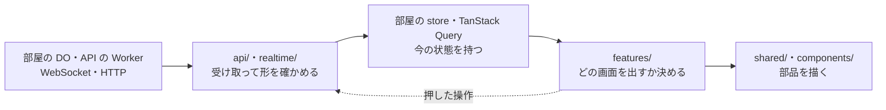

# 画面のコードの地図

`apps/web/src` のどこに何があり、部屋の DO や API から届いたものがどう画面になるかをまとめる。約束の理由と、コードのどこで守っているかは [frontend.md](../../../docs/architecture/frontend.md) にある。

## データの流れ

- 矢印はデータの向き。届いたものは左から右へ一方向に流れ、画面は届いたものを描くだけ。正本は部屋の DO にあり、端末は写しを持つ
- 押した操作（回答・ホストの進行）だけが、点線で入口へ戻り、そこから送られる
- import の向きは、入口の側だけ矢印の逆になる。`features/` は `realtime/`・`api/` を読んで届いたものを受け取り、`realtime/`・`api/` は `features/` を読まない。部品の側は矢印と同じ向きで、`features/` が `shared/`・`components/` を読んで描く
- `routes/` は図の外にある。URL ごとに features の画面を出し、部屋に入るときに `loader` で接続の操作役を作る（[接続を開く場所](../../../docs/architecture/frontend.md#接続を開く場所)）

## 層

上の層は下の層を読める。下から上は読まない。柵は `.oxlintrc.json` の `overrides` にあり、破ると `pnpm run lint` が落ちる（[全体の形](../../../docs/architecture/frontend.md#全体の形)）。

| フォルダー                       | 置くもの                                                                                                                              | 読んでよい先                                                                     |
| -------------------------------- | ------------------------------------------------------------------------------------------------------------------------------------- | -------------------------------------------------------------------------------- |
| [routes/](routes/)               | URL ごとのファイル。`loader` で読み込みと接続の操作役を用意し、features の画面を出す                                                  | ほかのすべて                                                                     |
| [features/](features/)           | 1つの画面のまとまり（`admin`・`guide`・`host`・`player`）。部屋の操作役（`host-room.ts`・`player-room.ts`）と、その画面だけで使う部品 | `shared/`・`api/`・`realtime/`・`components/`・`lib/`。ほかの feature は読まない |
| [shared/](shared/)               | 2つ以上の feature で使うもの（ログインの確認・接続の読み上げ・残り時間・結果・効果音）                                                | `api/`・`realtime/`・`components/`・`lib/`                                       |
| [api/](api/)                     | HTTP API を呼ぶ関数と `queryOptions`、Better Auth（`auth-client.ts`）                                                                 | `api/`・`realtime/`・`lib/`                                                      |
| [realtime/](realtime/)           | 部屋の WebSocket（`client.ts`）、つなぎ直しの間隔、部屋の store（`room-store.ts`）                                                    | `api/`・`realtime/`・`lib/`                                                      |
| [components/ui/](components/ui/) | shadcn の部品（`Button`・`Card`・`ConfirmDialog`・`Field`）                                                                           | `components/ui/`・`lib/` だけ                                                    |
| [components/](components/)       | `ui/` のほかの、画面に1つだけ置く部品（読み上げの `Announcer`・エラーの画面・アイコン）                                               | 柵はない。今は `components/` の中だけを読む                                      |
| [lib/](lib/)                     | どの層からも使う小さな道具（`cn`・`pageTitle`）                                                                                       | 外のパッケージだけ                                                               |

`src/` の直下には、入口の [main.tsx](main.tsx)、router と TanStack Query を作る [router.tsx](router.tsx)、`/api/*` を API の Worker へ転送する画面の Worker の [server.ts](server.ts)、色と文字のトークンの [styles.css](styles.css) がある。`routeTree.gen.ts` はルーターのプラグインが作る。

どの層も、メッセージと HTTP の形は [packages/protocol](../../../packages/protocol/src/)、点数と順位と秒の書き方は [packages/scoring](../../../packages/scoring/src/) から読む。

## X はどこに置くか

| 置きたいもの                                  | 置き場所                                                                                                                    |
| --------------------------------------------- | --------------------------------------------------------------------------------------------------------------------------- |
| 新しい URL の画面                             | `routes/` にルートのファイル、中身は `features/<画面>/`。`head: () => pageTitle('<画面名>')` を付ける                       |
| HTTP API を呼ぶ関数・`queryOptions`           | `api/`。応答は protocol のスキーマで確かめる                                                                                |
| 部屋から届くメッセージを状態に写す処理        | [realtime/room-store.ts](realtime/room-store.ts) の `applyServerMessage`                                                    |
| 部屋の接続の開け閉め・メッセージを送る操作    | `features/<画面>/` の操作役（[player-room.ts](features/player/player-room.ts)・[host-room.ts](features/host/host-room.ts)） |
| 効果音を鳴らすきっかけ                        | 鳴らす音は [shared/sound/sound-cues.ts](shared/sound/sound-cues.ts) が決め、操作役の `onMessage` で鳴らす                   |
| 1つの画面だけで使う部品                       | その `features/<画面>/` の中                                                                                                |
| 2つ以上の feature で使う部品・フック          | `shared/<名前>/`。feature 同士は読み合わないので、使う側が増えたらここへ移す                                                |
| ボタンやカードなどの見た目の部品              | `components/ui/`。shadcn の部品を手で写す（[UI の部品](../../../docs/architecture/frontend.md#ui-の部品)）                  |
| 部品のストーリー（Storybook）                 | 部品の隣の `<部品>.stories.tsx`（[Storybook](../../../docs/architecture/frontend.md#storybook)）                            |
| `cn` やページタイトルのような層によらない道具 | `lib/`                                                                                                                      |
| メッセージや HTTP の形                        | `apps/web` には置かず [packages/protocol](../../../packages/protocol/src/)。Go のバックエンドとも同じ形を使う               |
| 点数・順位・秒の書き方                        | `apps/web` には置かず [packages/scoring](../../../packages/scoring/src/)                                                    |
| テストの道具（偽の部屋のサーバーなど）        | [apps/web/test/](../test/)                                                                                                  |

## 1つのメッセージがボタンになるまで

回答者の端末に問題が届き、押せるボタンになるまでをたどる。部屋の DO は、読み上げのあいだ選択肢を送らない。選択肢を先に見て考える時間を稼げないようにするため（P2）。そのため、問題文を出す `questionShown` と、ボタンを出す `answeringStarted` の2段に分かれる。

接続は、回答者が部屋の URL を開いたときに [routes/r/$roomId.tsx](routes/r/$roomId.tsx) の `loader` が操作役を作り、名前を入れて「参加する」を押したとき（か、保存した秘密があれば `onEnter`）に開く。

### 1段目: `questionShown` で問題文が出る

1. 部屋の DO が `{ type: 'questionShown', questionId, questionIndex, questionCount, text, limitMs }` を送る
2. [realtime/client.ts](realtime/client.ts) の `connectRoom` が受け取り、`decodeServerMessage` で protocol の `serverMessageSchema` に通す。形が違えば、ここで捨てる
3. [features/player/player-room.ts](features/player/player-room.ts) の `connect` が `connectRoom` に渡した `onMessage` が呼ばれ、部屋の store の `receive` に渡す。同じところで効果音も鳴らす
4. [realtime/room-store.ts](realtime/room-store.ts) の `applyServerMessage` が、部屋の段階を `question` にし、今の問題 `question` を新しく作る。選択肢はまだないので `choices: null`
5. [features/player/PlayerPage.tsx](features/player/PlayerPage.tsx) の `RoomScreen` が `useStore` で store を読み、`QuestionView` を `questionId` を `key` にして出す
6. [features/player/QuestionView.tsx](features/player/QuestionView.tsx) は、段階が `question` なので、問題文と点線の枠と「選択肢は、ホストが受付を始めると出ます」を出す

### 2段目: `answeringStarted` でボタンになる

1. ホストが受付を始めると、部屋の DO が `{ type: 'answeringStarted', questionId, choices, limitMs, remainingMs }` を送る
2. 1段目の 2・3 と同じ道を通り、`applyServerMessage` に届く
3. `applyServerMessage` の `updateQuestion` が、`questionId` が今の問題と同じことを確かめてから `choices` と `remainingMs` を入れ、段階を `accepting` にする。違う問題へのメッセージは、遅れて届いたものとして無視する
4. `QuestionView` は、段階が `accepting` で `choices` があるので `Answering` を出す。`Answering` は残り時間を数え始め、[features/player/AnswerButtons.tsx](features/player/AnswerButtons.tsx) が選択肢ごとにボタンを描く

ボタンを押すと、図の点線の向きに戻る。`Answering` の `choose` が `onAnswer`（操作役の `answer`）を呼び、`connectRoom` の `send` が `answer` のメッセージを部屋の DO へ送る。画面は押した瞬間に「回答までの時間」を出し、受け付けられて `answerAccepted` が届くと、同じ道で store に入ったサーバーの時間に替える。

ホストの画面も同じ形で、操作役が [features/host/host-room.ts](features/host/host-room.ts)、画面が [features/host/HostPage.tsx](features/host/HostPage.tsx) になる。
